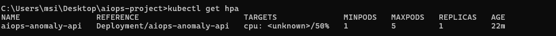

# AIOps Cloud Anomaly Detection & Monitoring

### Machine Learning | FastAPI | Docker | Kubernetes

## Overview

An AIOps (Artificial Intelligence for IT Operations) project designed to detect anomalies in cloud infrastructure workloads using Machine Learning.

The system analyzes cloud resource metrics, including CPU utilization, memory usage, disk I/O, network I/O, and workload type, to classify potentially abnormal behavior.

A REST API built with **FastAPI** serves the pre-trained machine learning model and provides anomaly predictions along with recommended recovery actions.

The project also includes Docker containerization and Kubernetes configuration files for deployment health monitoring.

## Key Features

- **ML-Based Anomaly Detection:** Classifies cloud workloads using a pre-trained machine learning model.
- **REST API:** Provides anomaly predictions through FastAPI.
- **Feature Preprocessing:** Applies workload encoding and feature scaling.
- **Recovery Recommendations:** Suggests restarting containers or scaling services when an anomaly is detected.
- **Docker Containerization:** Packages the application for container-based deployment.
- **Kubernetes Configuration:** Includes health probe and Metrics Server configuration patches.
- **Health Monitoring:** Provides an API health-check endpoint.
- **Input Validation:** Uses Pydantic models to validate incoming requests.

## System Architecture

```text
        Cloud Workload Metrics
                  |
                  v
          FastAPI REST API
                  |
                  v
          Input Validation
                  |
                  v
          Workload Encoding
                  |
                  v
           Feature Scaling
                  |
                  v
       Pre-trained ML Model
                  |
                  v
         Anomaly Prediction
                  |
           +------+------+
           |             |
           v             v
       Anomaly        Normal
           |             |
           v             v
    Recovery Action  System Healthy
    Recommendation
```

## Machine Learning Pipeline

The prediction pipeline uses three serialized artifacts:

| File | Purpose |
|------|---------|
| `model.pkl` | Pre-trained machine learning model |
| `scaler.pkl` | Fitted feature scaler |
| `workload_type_encoder.pkl` | Fitted workload type encoder |

### Prediction Process

1. Receive cloud workload metrics.
2. Validate the input data using Pydantic.
3. Encode the workload type.
4. Construct the feature vector.
5. Scale the features.
6. Generate a prediction using the trained model.
7. Return the anomaly status and recommended action.

The application interprets prediction class `1` as an anomaly.

### Input Features

| Feature | Description |
|---------|-------------|
| CPU_Usage | CPU utilization |
| Memory_Usage | Memory utilization |
| Disk_IO | Disk input/output metric |
| Network_IO | Network input/output metric |
| Workload_Type | Workload category |

Input values should follow the same units and conventions used during model training.

## API Endpoints

### GET /healthz

Checks whether the API is responding.

**Example Response:**

```json
{
  "status": "ok"
}
```

### POST /predict

Receives cloud workload metrics and returns an anomaly prediction.

**Example Request Format:**

```json
{
  "CPU_Usage": 75.0,
  "Memory_Usage": 68.0,
  "Disk_IO": 120.0,
  "Network_IO": 45.0,
  "Workload_Type": "REPLACE_WITH_VALID_CATEGORY"
}
```

Replace the workload type placeholder with a category supported by the fitted encoder.

**Example Anomaly Response:**

```json
{
  "anomaly": true,
  "recommended_action": "restart_container_or_scale_service"
}
```

**Example Normal Response:**

```json
{
  "anomaly": false,
  "recommended_action": "system_healthy"
}
```

The examples illustrate the response format, not verified predictions for the sample input.

**Important:** Recovery actions are recommendations only. The application does not automatically restart containers or scale Kubernetes workloads.

## Technologies Used

| Technology | Purpose |
|------------|---------|
| Python | Backend development |
| FastAPI | REST API framework |
| Scikit-learn | Machine learning inference |
| Pandas | Feature preparation |
| Pydantic | Request validation |
| Joblib | Loading trained ML artifacts |
| Docker | Application containerization |
| Kubernetes | Deployment configuration |
| Uvicorn | ASGI application server |

## Installation and Setup

### Prerequisites

- Python 3.11
- pip
- Docker (optional)
- Kubernetes cluster (optional)

### 1. Clone the Repository

```bash
git clone https://github.com/Belalzz20/AIOps-Cloud-Anomaly-Detection.git
cd AIOps-Cloud-Anomaly-Detection
```

### 2. Install Dependencies

```bash
pip install -r requirements.txt
```

### 3. Run the Application

```bash
uvicorn app:app --host 127.0.0.1 --port 8000
```

### 4. Access the API

Interactive API documentation:

http://127.0.0.1:8000/docs

Health-check endpoint:

http://127.0.0.1:8000/healthz

## Docker Deployment

### Build Docker Image

```bash
docker build -t aiops-cloud-api .
```

### Run Docker Container

```bash
docker run --rm -p 8000:8000 aiops-cloud-api
```

The API should then be accessible at:

http://localhost:8000

## Kubernetes Configuration

The repository contains Kubernetes configuration patches.

### Health Probes

`probes-patch.json`

Includes configuration for:

- Liveness probes.
- Readiness probes.
- API health endpoint monitoring.

### Metrics Server

`metrics-patch.json`

Includes configuration for the Kubernetes Metrics Server.

The configuration contains a TLS verification bypass setting intended for development or testing environments. It should be reviewed before production deployment.

### Horizontal Pod Autoscaling

The project includes a screenshot related to Kubernetes Horizontal Pod Autoscaling (HPA).

A complete HPA manifest is not included in the repository.

## Deployment Screenshots

### Kubernetes Deployment


### Kubernetes Pod


### Horizontal Pod Autoscaler



These screenshots document deployment-related information from the project environment.

## Project Structure

```text
AIOps-Cloud-Anomaly-Detection/
│
├── app.py
├── Dockerfile
├── requirements.txt
├── model.pkl
├── scaler.pkl
├── workload_type_encoder.pkl
├── metrics-patch.json
├── probes-patch.json
├── README.md
│
└── Screenshots/
    ├── Deployment Description.png
    ├── Pod Description.png
    └── Hpa.png
```

## Current Limitations

- Model training scripts are not included.
- Model evaluation metrics are not documented.
- Automatic infrastructure remediation is not implemented.
- Live infrastructure metric collection is not integrated.
- Complete Kubernetes Deployment, Service, and HPA manifests are not included.
- The health endpoint does not independently verify model inference.

## Future Improvements

- Integrate Prometheus for real-time cloud monitoring.
- Implement automated Kubernetes recovery actions.
- Add complete Kubernetes deployment manifests.
- Introduce automated API testing.
- Add model evaluation and performance reports.
- Implement monitoring dashboards.
- Improve logging and error handling.
- Add CI/CD pipelines.

## Learning Outcomes

This project demonstrates practical experience with:

- Machine learning model deployment.
- REST API development using FastAPI.
- Feature encoding and scaling.
- Docker containerization.
- Kubernetes configuration.
- API health monitoring.
- Cloud anomaly detection concepts.
- AI-assisted infrastructure management.

## Project Information

**Project Type:** AIOps / Cloud Computing / Machine Learning

**Programming Language:** Python

**Backend Framework:** FastAPI

**Deployment Technologies:** Docker and Kubernetes

**Status:** Anomaly detection API with recovery recommendations and deployment configuration artifacts.

## License

No license has been specified for this project.
